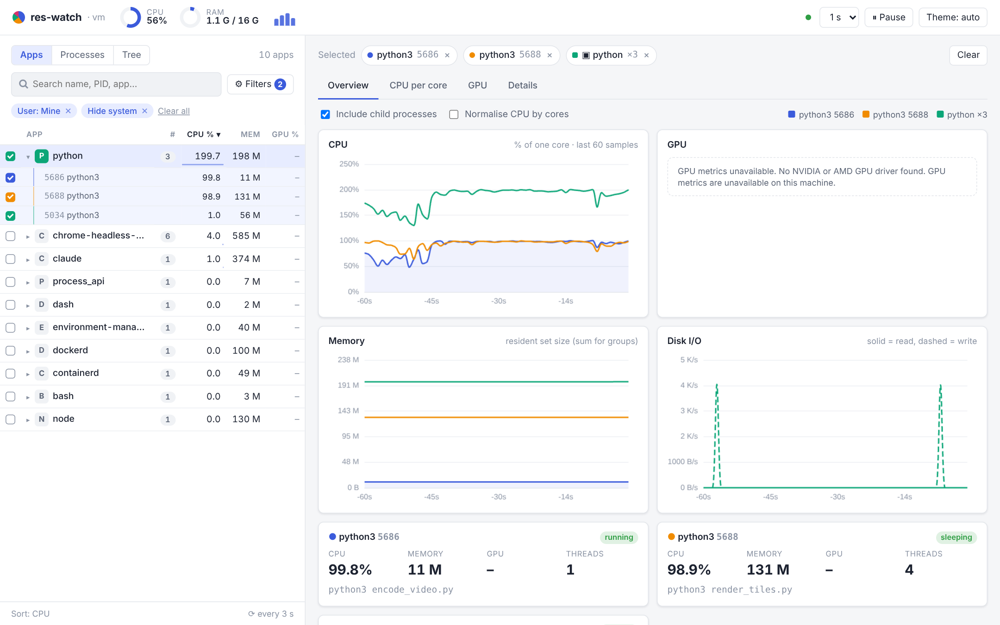
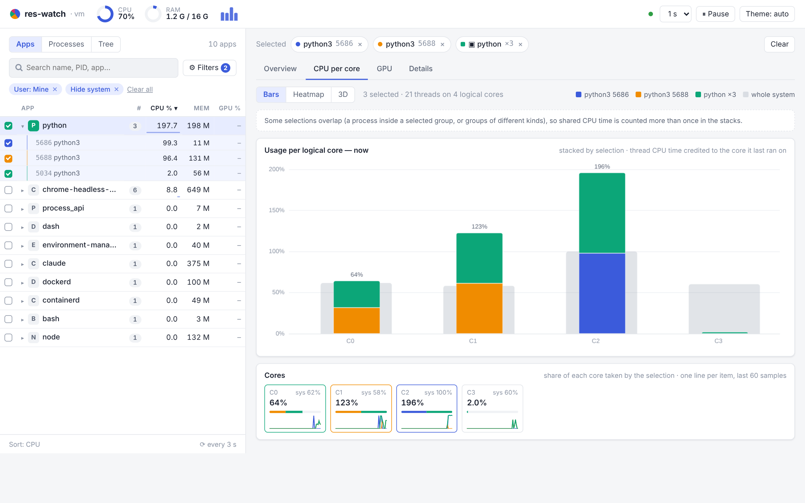
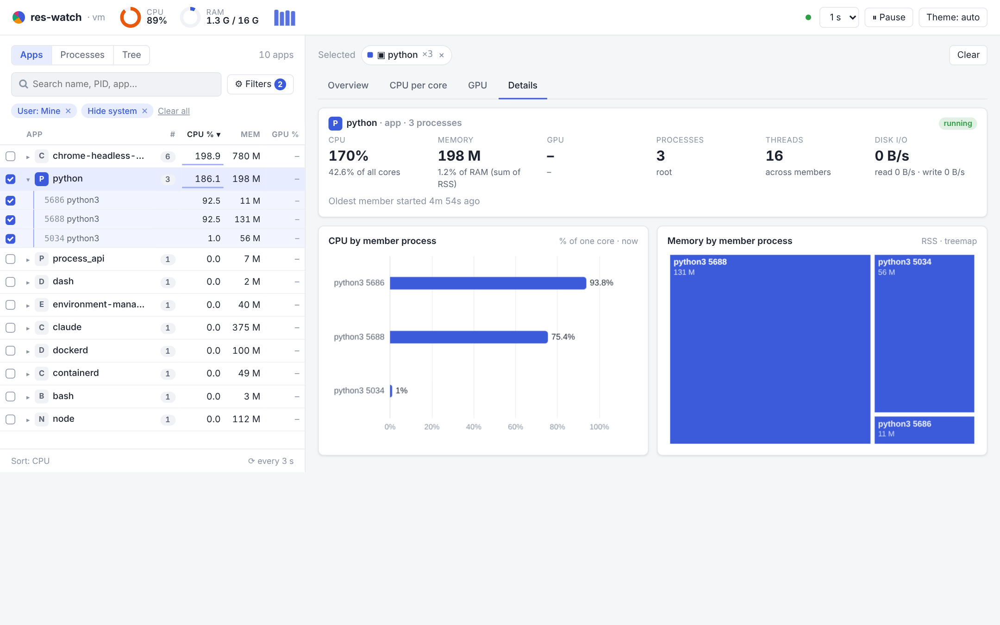
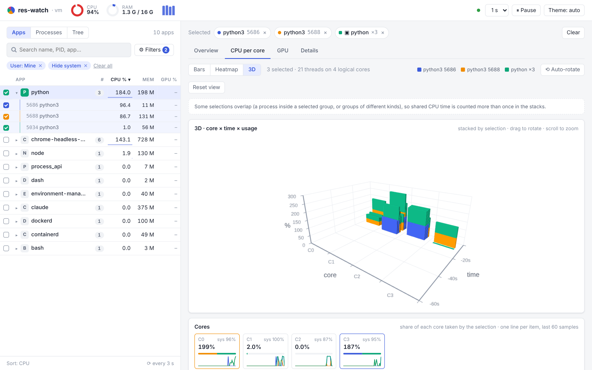
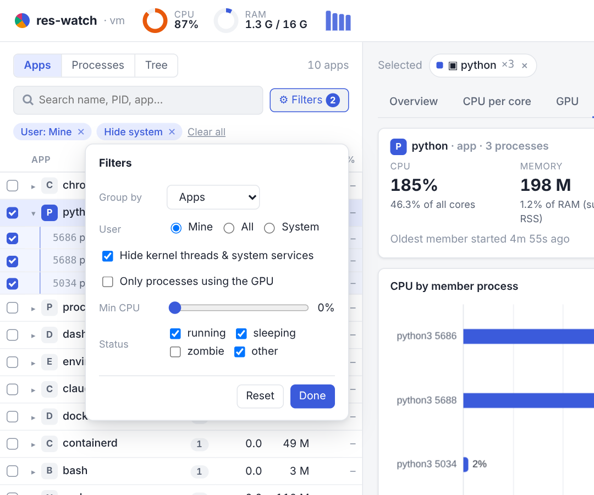

# res-watch

See what each **app or process** on a machine is using, live: CPU (including **per core**), GPU, memory and disk I/O, in 2D and 3D charts. The backend is Python (FastAPI + psutil) and the frontend is a web UI. It runs on your laptop or on a VPS.



- **Apps / Processes / Tree** sidebar. Processes are grouped into apps, for example all 23 Chrome processes become one `chrome` app. You can chart a whole app, a single process, or a mix of both. **Group by** can also group by executable or by user.
- **Filters:** mine/all/system users, hide kernel threads and system services, GPU users only, minimum CPU %, and process status. They are remembered in the browser.
- **Charts start with history:** the server keeps the last minute for every process, so a newly selected item shows it straight away, and your selection comes back after a page reload.
- **Everything you select is shown together:** tick several apps and/or processes and each one gets its own colour in every chart and its own section in Details.
- **CPU per core:** bars stacked by selection over whole-system usage, one core × time heatmap per selection, and a rotatable 3D view stacked by selection (it keeps your camera angle; hidden on phones narrower than 480px). Per-process per-core usage is Linux only, see [Notes](#notes).
- **GPU:** utilisation, memory, temperature, power, and the SM, memory, encoder and decoder engines, plus GPU use per process. NVIDIA is supported via NVML; AMD support is best effort via `amdsmi`.
- **Details:** for an app, CPU per member process and a memory treemap; for a process, its command line, user, threads and open files.
- **Built-in login** for remote servers. It is off on localhost.

## Screenshots

These come from the running app on a small 4-core Linux machine with no GPU.

| CPU per core, stacked by selection | One app in detail |
|---|---|
|  |  |
| **3D view (core × time × usage)** | **Filters and "Group by"** |
|  |  |

## Quick start

```bash
git clone <this repo> res-watch && cd res-watch
./setup.sh
```

On Windows (PowerShell):

```powershell
powershell -ExecutionPolicy Bypass -File setup.ps1
```

The setup script creates `.venv`, installs the dependencies (plus GPU support when `nvidia-smi` is present), and then asks:

1. **Where will you run it?** Local machine only / VPS or remote server / both.
2. **Local:** which OS, and how it should start: manually, at login (systemd user service, LaunchAgent or Task Scheduler), or with Docker.
3. **VPS:** how it runs (systemd, `docker run`, Docker Compose or tmux), what sits in front (SSH tunnel, Caddy, nginx, Traefik, Apache, Cloudflare Tunnel/Access or other), whether HTTPS and a domain are already set up, and whether to use the built-in login or your proxy's SSO.

The script shows numbered steps (`[1/5] Checking Python` … `[5/5] Running the setup wizard`). In a terminal, the steps that print nothing show a spinner and pip shows its progress bars; with `--yes`, piped output, or `CI` set, the output is plain text so logs stay clean. The wizard shows `Question X of Y`, where Y updates as your answers open or skip follow-up questions. It lists each file as `[i/N] wrote …`.

It generates **only** the files that match your answers and prints the next steps. Re-run it any time; your previous answers become the defaults, and it shows a diff before it changes a file.

Every question has a flag, so setup can also run without prompts:

```bash
./setup.sh --yes --where vps --run compose --proxy caddy --domain mon.example.com --https docs --auth builtin
```

Run `python -m reswatch setup --help` to see all options.

## Running locally

```bash
.venv/bin/python -m reswatch
```

Then open http://localhost:8000. By default it listens on `127.0.0.1:8000` only, with no login.

| Option | Env var | Default | |
|---|---|---|---|
| `--host` | `RESWATCH_HOST` | `127.0.0.1` | bind address |
| `--port` | `RESWATCH_PORT` | `8000` | |
| `--interval` | `RESWATCH_INTERVAL` | `1` | seconds between samples |
| `--base-path` | `RESWATCH_BASE_PATH` | *(root)* | serve under a sub-path such as `/reswatch` |
| `--auth on/off/auto` | `RESWATCH_AUTH` | `auto` | `auto` turns the login on for non-localhost binds |
| `--no-auth` | | | same as `--auth off` |
| `--trusted-proxy` | `RESWATCH_TRUSTED_PROXY` | off | trust `X-Forwarded-For` / `X-Forwarded-Proto` |
| `--session-hours` | `RESWATCH_SESSION_HOURS` | `12` | login session lifetime |
| `--config-dir` | `RESWATCH_CONFIG_DIR` | `~/.config/reswatch` (`%APPDATA%\reswatch` on Windows) | |

Settings are applied in this order, with later ones winning: defaults, then `config.toml` (written by setup), then env vars, then CLI flags.

**Start at login** (setup writes these files for you):

- Linux: `~/.config/systemd/user/reswatch.service`, enabled with `systemctl --user enable --now reswatch`.
- macOS: `~/Library/LaunchAgents/dev.reswatch.plist`, loaded with `launchctl load -w …`.
- Windows: a Task Scheduler task created with `schtasks /Create /TN res-watch /SC ONLOGON …`. The setup output shows the full command.

**Docker on your own machine:** setup writes a `Dockerfile` and prints the `docker run` command. The command includes `--pid=host`, which the container needs to see your processes, and `-p 127.0.0.1:8000:8000` so the port is not exposed.

## Running on a VPS

Never expose port 8000 directly. Keep res-watch on `127.0.0.1` and use one of these:

- **SSH tunnel** (no proxy, no domain needed):

  ```bash
  ssh -N -L 8000:127.0.0.1:8000 you@server
  ```

  Then open http://localhost:8000.
- **Reverse proxy with HTTPS:** setup writes `deploy/Caddyfile`, `deploy/nginx.conf`, `deploy/apache.conf`, `deploy/traefik-dynamic.yml` (or Traefik labels in the compose file), or `deploy/cloudflared.yml`. Each one handles HTTPS, the WebSocket upgrade for `/ws`, the forwarded headers and an optional sub-path, and has its install steps at the top of the file. If you answer that HTTPS still needs setting up, setup also prints the DNS and certificate steps (Caddy's automatic HTTPS, certbot for nginx/Apache, or Traefik ACME).

How it runs on the server:

- **systemd:** `deploy/reswatch.service` runs as your user with a hardened unit:

  ```bash
  sudo cp deploy/reswatch.service /etc/systemd/system/
  sudo systemctl daemon-reload
  sudo systemctl enable --now reswatch
  ```

- **Docker / Compose:** `Dockerfile`, plus `docker-compose.yml` if you chose Compose. Both use `pid: host` / `--pid=host` to see the host's processes, publish only on `127.0.0.1`, and run with a read-only filesystem and all capabilities dropped. GPU metrics need the [NVIDIA Container Toolkit](https://docs.nvidia.com/datacenter/cloud-native/container-toolkit/) (`--gpus all`; the GPU lines are added automatically when a GPU is detected).
- **tmux:** setup prints the command to run.

**Login** (single admin user):

```bash
.venv/bin/python -m reswatch set-password
```

This prompts for the password without echoing it and writes `~/.config/reswatch/auth.json` with mode 0600. The file stores only a salted scrypt hash.

To configure the login with env vars instead, run:

```bash
.venv/bin/python -m reswatch hash-password
```

Put its output in `RESWATCH_USERNAME`, `RESWATCH_PASSWORD_HASH` and `RESWATCH_SECRET_KEY`.

- If the server is started on a non-localhost address with no password configured, it **refuses to start**. If your proxy or SSO already authenticates users (for example Cloudflare Access or oauth2-proxy), start it with `--no-auth`; it prints a warning.
- Sessions use a signed cookie (HttpOnly, SameSite=Strict, and Secure over HTTPS) that lasts 12 h by default. Changing the password logs everyone out. There is a "Log out" button in the top bar.
- Failed logins are rate-limited per IP. After 5 failures the IP is locked out for 30 s, then 1, 2, 4 … minutes, up to 15 min.
- `X-Forwarded-*` headers are only trusted with `--trusted-proxy`. Setup turns this on when you choose a proxy.

**Firewall:** allow only SSH, plus 80/443 if you use a proxy:

```bash
sudo ufw allow OpenSSH
sudo ufw allow 80,443/tcp
sudo ufw enable
```

## Notes

- **Per-core usage of a single process** is only available on Linux. Each thread's CPU time is credited to the core it last ran on (from `/proc/<pid>/task/*/stat`), so a thread that moved mid-interval is counted on its new core; the per-core values always add up to the process total. On macOS and Windows the CPU tab shows whole-system usage per core.
- **App memory** is the sum of the members' RSS by default, so shared pages are counted more than once. On Linux, tick **Fair memory (PSS)** on the Overview tab to split shared pages between the processes using them instead; it is sampled only for what you have selected, and the Details tab shows both.
- **Permissions:** run as a normal user and you'll see everything about your own processes. For other users' processes, some fields (I/O, executable path) show 🔒 n/a unless res-watch runs with more privileges.
- **How processes are grouped into apps:** first macOS `.app` bundles, then Linux systemd/snap/flatpak app scopes (except terminal-like launchers), then the process tree: a process joins its parent if they share an executable or a non-generic install folder.
- **GPU:** if no NVIDIA or AMD driver is found, the GPU tab says "GPU metrics unavailable" and everything else keeps working.

## Development

What's left to do, and in what order, is in [`docs/ROADMAP.md`](docs/ROADMAP.md).

```bash
.venv/bin/pip install -r requirements-dev.txt
.venv/bin/python -m pytest
```

- `reswatch/`
  - `monitor.py`: sampling
  - `percore.py`: per-core attribution
  - `apps.py`: grouping into apps
  - `gpu.py`: GPU metrics
  - `auth.py`: login
  - `main.py`: API and WebSocket
  - `setup_wizard.py` and `templates/`: the setup script
- `static/`: frontend (ECharts 5.6 and ECharts-GL 2.0.9 are vendored in `static/vendor/`, so it works offline)
- `design/`: the static mockup with sample data (16 cores, a GPU) and its reference images; rebuild them with `node design/render.js`
- `docs/screenshots/`: real screenshots used in this README

Licences for the vendored chart libraries are in `static/vendor/LICENSE-*` (Apache-2.0).
